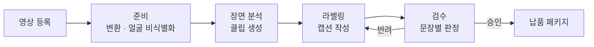
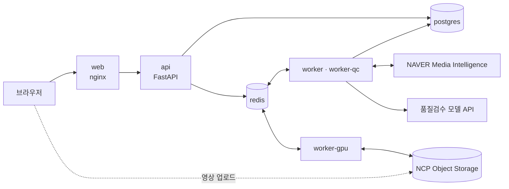

<p align="center">
  
</p>

<h1 align="center">RebornStudio</h1>

<p align="center">보도영상을 VLM(시각 언어 모델) 학습 데이터로 가공하는 작업 관리 플랫폼</p>

<p align="center">
  <a href="LICENSE"></a>
</p>

<p align="center">
  <a href="docs/install.md">설치 안내</a> ·
  <a href="docs/README.md">문서 지도</a> ·
  <a href="SECURITY.md">보안 취약점 신고</a>
</p>

> [!NOTE]
> 영상 파일은 NCP Object Storage에 두고, 장면 분석은 NAVER Media Intelligence가 합니다. 두 서비스의 계정과 접근 키가 있어야 영상을 등록하고 클립을 만들 수 있습니다.

## 소개

RebornStudio는 보도영상을 등록하는 단계부터 학습 데이터로 납품하는 단계까지 한 흐름으로 다룹니다.
등록한 영상은 변환과 얼굴 비식별화를 거쳐 장면 단위 클립으로 나뉩니다. 여러 라벨러가 클립마다 캡션을 쓰면 검수자가 문장별로 판정하고, 승인된 클립은 메타데이터와 캡션을 담은 납품 패키지로 내보냅니다.
GPU 서버 한 대에서 전체 흐름이 돌도록 구성했습니다.



## 역할

| 역할 | 하는 일 |
|---|---|
| 최고관리자 | 프로젝트와 사용자를 만들고, 자격증명 연결과 플랫폼 설정을 관리합니다 |
| 관리자 | 프로젝트의 대기열 · 설정 · 멤버를 관리하고 납품 패키지를 내보냅니다 |
| 검수자 | 제출된 캡션을 문장별로 판정하고 반려 사유를 남깁니다 |
| 라벨러 | "다음 작업" 버튼으로 클립을 한 건씩 받아 캡션을 쓰고 제출합니다 |

## 기능

| 영역 | 내용 |
|---|---|
| 영상 등록 | 브라우저 업로드(멀티파트, 이어받기)와 Object Storage 경로 입력(파일 경로, 폴더 경로). 영상 메타데이터 일괄 입력 |
| 준비 | 재생본 · 분석본 변환, 장면 분할, 얼굴 비식별화(YuNet 검출, 추적, 모자이크). GPU가 있으면 검출과 인코딩에 GPU를 씁니다 |
| 장면 분석 | NAVER Media Intelligence로 장면을 나누고 클립을 만듭니다 |
| 라벨링 | "다음 작업" 버튼 하나로 서버가 고른 클립을 한 건씩 받아 캡션 작성. 분석 결과로 초안 채우기, 임시저장, 비식별화 미흡 신고 |
| 검수 | "다음 검수" 버튼 하나로 한 건씩 받아 문장별 판정, 반려 사유와 보충 설명, 재작업 |
| 캡션 품질검수 | 외부 언어 모델(OpenAI 호환, Anthropic, Bedrock 등)로 캡션을 점검하고 보류 건을 처리합니다. 쓰지 않아도 됩니다 |
| 납품 | 승인된 클립의 메타데이터, 캡션, 원본 영상 목록, 제외 사유 리포트를 zip 패키지로 내보냅니다. 영상 파일은 넣지 않습니다 |
| 운영 | 기간 합계와 사람별 실적 표(제출, 판정, 승인율, 반려율, 수정률), 감사 기록 보관, 15분 주기 연동 점검, 12시간 주기 DB 백업, 최고관리자 비밀번호 복구 명령 |

## 요구 사항

| 항목 | 기준 |
|---|---|
| 서버 | Ubuntu 22.04 또는 24.04, Docker와 docker compose v2 |
| 사양 | 예: vCPU 8 · 메모리 32GB · 디스크 100GB 이상. 처리할 양에 맞춰 [`docs/install.md`](docs/install.md#서버-사양)의 산식으로 정합니다 |
| GPU | 선택. NVENC가 있는 NVIDIA GPU와 드라이버 570 이상. 없으면 검출과 인코딩이 CPU로 돌아 느려집니다 |
| 외부 서비스 | NCP Object Storage 버킷 둘(산출물용, 백업용), NAVER Media Intelligence 워크스페이스와 분석 프로젝트, 캡션 품질검수 모델 API(선택) |

## 빠른 시작

서버 준비(Docker, GPU 드라이버, 실행 계정)와 외부 서비스 준비는 [`docs/install.md`](docs/install.md#설치-전-준비)의 "설치 전 준비"를 먼저 따릅니다.

1. 저장소를 받고 설정 파일을 만듭니다.

   ```bash
   git clone https://github.com/DAC-SFACSPACE/rebornstudio.git /opt/rebornstudio
   cd /opt/rebornstudio
   cp infra/deploy/env.example .env
   chmod 600 .env
   ```

2. `.env`에 아래 값을 채웁니다. 키마다 뜻은 [`docs/env-catalog.md`](docs/env-catalog.md)에 있습니다.

   | 키 | 값 |
   |---|---|
   | `POSTGRES_PASSWORD`, `JWT_SECRET`, `JWT_REFRESH_SECRET`, `CREDENTIALS_KEY` | 각각 `openssl rand -hex 32`로 만든 값 |
   | `GPU_ENABLED` | GPU 서버면 `true` |
   | `BACKUP_BUCKET`, `BACKUP_ACCESS_KEY`, `BACKUP_SECRET_KEY` | DB 백업 버킷과 그 버킷 전용 키. 비어 있으면 배포가 시작되지 않습니다 |
   | `IMAGE_REGISTRY` | 서버에서 이미지를 빌드하면 `local` |

3. 이미지를 빌드하고 실행합니다. `deploy.sh`가 DB 마이그레이션, 기동, 헬스 확인을 차례로 합니다.

   ```bash
   infra/deploy/build-images.sh
   IMAGE_TAG=sha-$(git rev-parse HEAD) DEPLOY_PULL=false infra/deploy/deploy.sh
   ```

4. api 로그에서 셋업 토큰을 확인합니다.

   ```bash
   infra/deploy/dc.sh logs api | grep '셋업 토큰'
   ```

5. 브라우저로 서버 주소에 접속해 셋업 토큰으로 최고관리자를 만들고 로그인합니다.
6. 관리자 화면의 "자격증명 연결"에 산출물 버킷, Media Intelligence, 품질검수 모델을 등록합니다. 접근 키는 `.env`가 아니라 여기에 등록하고, 서버가 DB에 암호화해 저장합니다.

> [!WARNING]
> 기본 구성은 TLS 없이 80 포트(http)로 열립니다. 운영하기 전에 앞단에 TLS를 둡니다([`docs/install.md`](docs/install.md#tls)의 "TLS").

업그레이드와 되돌리기는 [`docs/install.md`](docs/install.md#업그레이드)의 "업그레이드"에, DB 백업 복원은 [`infra/backup/README.md`](infra/backup/README.md)에 있습니다.

## 구성



| 서비스 | 하는 일 |
|---|---|
| `web` | 화면(React 정적 파일)과 `/api` 프록시(nginx). 외부에 여는 포트는 80 하나입니다 |
| `api` | 서버 API(FastAPI) |
| `postgres`, `redis` | 메타데이터 DB, 작업 큐와 세션 |
| `worker` | 짧은 작업과 주기 작업(분석 결과 회수, 썸네일, 내보내기) |
| `worker-qc` | 캡션 품질검수 |
| `worker-gpu` | 긴 작업(변환, 장면 분할, 비식별화). DB에 붙지 않고 작업 내용만 받아 처리합니다 |
| `pg-backup` | DB 백업. 12시간마다 백업 버킷에 올리고 30일치를 보관합니다 |

| 폴더 | 내용 |
|---|---|
| `apps/api-gateway` | 서버 API와 DB 마이그레이션 |
| `apps/web` | 화면 |
| `workers/worker-io` | DB를 쓰는 짧은 작업과 주기 작업 |
| `workers/worker-jobs` | DB 없이 도는 긴 작업 |
| `packages/reborn-contracts` | 서버, 워커, 화면이 같이 쓰는 스키마와 큐 계약 |
| `packages/reborn-transcode` | 변환과 장면 분할 등 미디어 처리 |
| `packages/deident` | 영상 얼굴 비식별화 모듈 |
| `infra` | 컨테이너 이미지, compose 구성, 배포 스크립트, DB 백업 |

폴더마다 README가 있고, 그 폴더의 목적, 주요 파일, 설계 이유를 설명합니다.

## 문서

| 알고 싶은 것 | 문서 |
|---|---|
| 서버 사양 산식, 설치, 업그레이드, TLS, 보안 설정 | [`docs/install.md`](docs/install.md) |
| 환경변수 키의 뜻 | [`docs/env-catalog.md`](docs/env-catalog.md) |
| 배포 스크립트와 롤백 | [`infra/deploy/README.md`](infra/deploy/README.md) |
| DB 백업과 복원 | [`infra/backup/README.md`](infra/backup/README.md) |
| 로컬 개발 스택 | [`infra/compose/README.md`](infra/compose/README.md) |
| 서버 API 명세(OpenAPI) | [`docs/api/openapi.json`](docs/api/openapi.json) |
| 작업 큐와 태스크 계약 | [`packages/reborn-contracts/queues.md`](packages/reborn-contracts/queues.md) |
| 전체 문서 지도 | [`docs/README.md`](docs/README.md) |

## 개발

로컬 개발 스택은 docker compose로 띄웁니다. 개발 환경변수 예시는 루트 `.env.example`에 있습니다.

```bash
make dev-up        # 화면 3000, API 8000, postgres, redis, 워커 기동
make dev-migrate   # 스키마 생성
make seed-dev      # 최고관리자 계정과 라벨링 화면용 샘플 데이터
make dev-token     # 로그인 세션을 심는 브라우저 콘솔 명령 한 줄 출력
```

처음 띄울 때의 순서와 주의점은 [`infra/compose/README.md`](infra/compose/README.md#처음-띄울-때)에 있습니다.
CI와 같은 검사는 `make verify`(정적 검사와 계약 검사)와 `make verify-all`(위 검사와 전체 테스트)로 로컬에서 먼저 돌립니다.

## 기여

외부 PR은 받지 않습니다. 버그와 제안은 이슈로 남겨 주십시오.

## 보안

보안 취약점은 공개 이슈에 쓰지 말고 [`SECURITY.md`](SECURITY.md)의 절차대로 GitHub 비공개 취약점 신고로 알려 주십시오.

## 문의

RebornStudio 도입과 운영에 관한 문의는 수행기관인 주식회사 스팩스페이스(help@sfacspace.com)로 보내 주십시오.

## 사업 개요와 지원

이 저장소는 아래 사업에서 개발한 RebornStudio의 소스입니다.

| 항목 | 내용 |
|---|---|
| 사업명 | AI Agent 기반 보도영상 학습데이터 가공 플랫폼 구축 용역 |
| 기간 | 2026. 7. 6. ~ 2026. 10. 30. |
| 발주 | 한국방송공사(KBS) |
| 수행 | 주식회사 스팩스페이스 |
| 지원 | 한국언론진흥재단 |

본 시스템은 한국언론진흥재단의 지원을 받아 개발되었습니다.

## 라이선스

소스는 [Apache License 2.0](LICENSE)을 따릅니다. 저작권자는 한국방송공사(KBS)입니다.
저장소에 함께 들어 있거나 이미지에 함께 들어가는 제3자 구성 요소의 고지는 [`NOTICE`](NOTICE)에 있습니다. 이미지에 설치되는 나머지 소프트웨어의 라이선스는 [`docs/install.md`](docs/install.md#제3자-소프트웨어)의 "제3자 소프트웨어"에 있습니다.
